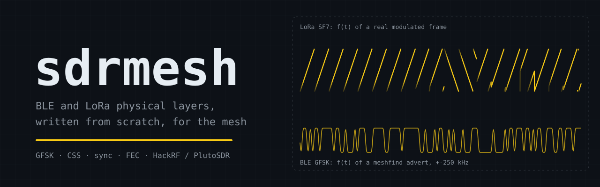
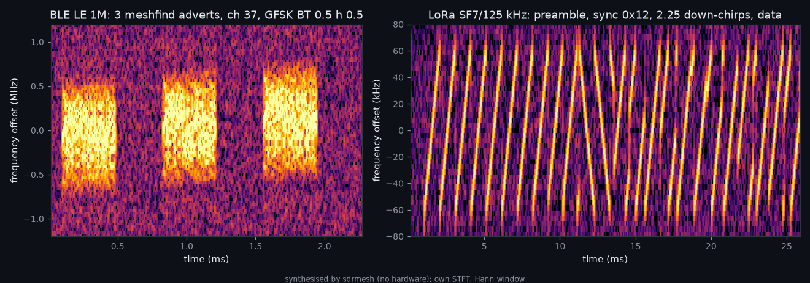
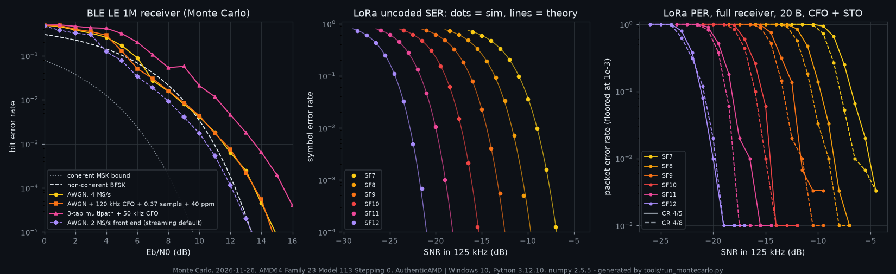
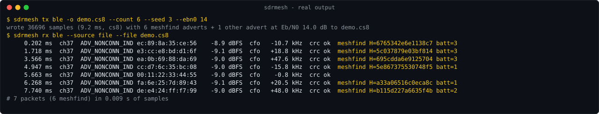
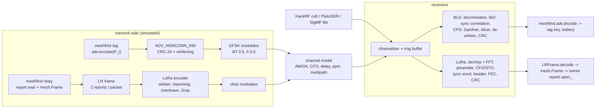

<p align="center">
  
</p>

<p align="center">
  <a href="https://github.com/coopersimpson101-debug/sdrmesh/actions/workflows/ci.yml"></a>
  <a href="https://github.com/coopersimpson101-debug/sdrmesh/releases/latest"></a>
  <a href="LICENSE"></a>
  
  
  
</p>

**A software-defined radio stack for the [meshfind](https://github.com/coopersimpson101-debug/meshfind) mesh:
the BLE and LoRa physical layers written from scratch in Python/NumPy (modulation, demodulation,
synchronisation, error correction), so a HackRF or PlutoSDR can hear meshfind tags and prototype the
routers' long-range link.**

<p align="center">
  <a href="#quickstart">Quickstart</a> ·
  <a href="#how-it-works">How it works</a> ·
  <a href="#results">Results</a> ·
  <a href="#hardware-validation--todo-for-the-author">Hardware TODO</a> ·
  <a href="docs/PHY_NOTES.md">PHY notes</a> ·
  <a href="docs/LINK.md">LoRa link spec</a>
</p>

<p align="center">
  <br>
  <sub>Real output of this repository's modulators, through its own STFT: three meshfind adverts on BLE
  channel 37 (left, each with a different CFO) and a LoRa SF7/125 kHz frame carrying a meshfind report frame
  (right: 8 up-chirps, sync word 0x12, 2.25 down-chirps, data). Synthesised; no radio involved.
  Regenerate with <a href="docs/assets/make_figures.py"><code>docs/assets/make_figures.py</code></a>.</sub>
</p>

<p align="center">
  <br>
  <sub>Monte Carlo through the full receivers (sync included), 26 Nov 2026, Ryzen 5 3600 / Windows 10 /
  Python 3.12 / NumPy 2.5. Left: BLE BER vs the non-coherent BFSK and coherent MSK curves. Middle: LoRa uncoded
  SER (dots) on top of the non-coherent orthogonal-FSK integral (lines). Right: LoRa packet error rate with
  random CFO and timing. Data: <a href="docs/results/">docs/results/</a>.</sub>
</p>

<p align="center">
  <br>
  <sub>Real stdout of <code>sdrmesh rx ble</code> on a synthetic cs8 capture (Eb/N0 14 dB): six meshfind tags
  decoded (key hash, battery) and one non-meshfind advert recognised as such.</sub>
</p>

## Highlights

- 📡 **Two PHYs from first principles**: BLE LE 1M (GFSK BT 0.5, h 0.5) and LoRa CSS (SF7 to SF12,
  125/250/500 kHz, CR 4/5 to 4/8). NumPy is used for arrays, FFTs and convolution only; every filter design,
  estimator, loop, code and parser is written here.
- 🎯 **BLE within 0.7 dB of the non-coherent BFSK curve**: 11.6 dB Eb/N0 for BER 1e-3 at 4 MS/s, 10.5 dB with
  the 2 MS/s front end the streaming receiver uses; still 11.7 dB with 120 kHz CFO, a fractional delay and a
  40 ppm clock offset (simulated).
- 📈 **LoRa matches theory**: the simulated uncoded SER crosses 1e-3 within 0.3 dB of the analytic value for
  SF7 to SF10 and SF12 (0.9 dB for SF11); the full receiver reaches 10 % PER at -7.9 dB (SF7, CR 4/8) down to
  -21.1 dB (SF12, CR 4/5) with ±20-bin CFO and fractional timing (simulated).
- 🔑 **meshfind end to end**: adverts generated by meshfind's own reference code go through GFSK, the channel
  model and the receiver, and `meshfind.adv.decode` recovers the 32-byte rotating key; reports sealed by
  meshfind cross a simulated LoRa link and the owner decrypts them.
- 🧰 **SDR I/O**: cs8/cs16/cf32, SigMF, `hackrf_transfer` and pyadi-iio sources, a ring buffer and a
  block-boundary-safe streaming receiver; it ran at **1.33x real time on a 4 MS/s stream** on this machine
  (synthetic stream, no hardware).
- 🛰️ **Long-range link prototype**: a 250-byte LoRa frame carries two 120-byte meshfind report frames;
  time on air matches the Semtech formula sample for sample, with throughput and link-budget tables.
- ✅ **120 tests** (unit, Monte Carlo smoke tests against theory, CLI and meshfind end-to-end), run in CI on
  Ubuntu and macOS with Python 3.10 and 3.12.

## Status

| Area | Status |
|---|---|
| BLE LE 1M: modulator, channel select, CFO, Gardner timing, sync, de-whitening, CRC-24, PDUs | ✅ implemented and tested here |
| LoRa: chirps, detection, CFO/STO, sync word, Gray, interleaver, Hamming, whitening, header, CRC, LDRO | ✅ implemented and tested here |
| meshfind adverts decoded end to end; meshfind reports over the LoRa link | ✅ tested here with the real meshfind package |
| BER/SER/PER vs SNR, against theory | 🧪 Monte Carlo on this machine (AWGN, CFO, timing, clock offset, multipath) |
| Compatibility with real BLE devices / SX127x radios / gr-lora_sdr | ⏳ validated only against this repo's own modulators (see [PHY notes](docs/PHY_NOTES.md)) |
| SigMF, cs8/cf32 files, ring buffer, streaming, stdin pipes | ✅ tested here |
| Live `sdrmesh rx ble --source hackrf` / `--source pluto` | ⏳ implemented, never run with hardware |
| Real-time margin on a live stream | 🧪 1.33x at 4 MS/s on a synthetic stream; ⏳ live |

## Quickstart

```bash
git clone https://github.com/coopersimpson101-debug/sdrmesh && cd sdrmesh
pip install -e ".[test,meshfind,plot]"            # numpy, plus meshfind from GitHub for tag decoding
python -m pytest -q                                # 120 tests
sdrmesh tx ble -o demo.cs8 --count 6 && sdrmesh rx ble --source file --file demo.cs8
sdrmesh rx ble --source hackrf                     # live, channel 37 (needs a HackRF; not yet tested)
```

## How it works



### BLE LE 1M ([`sdrmesh/ble/`](sdrmesh/ble))

**Modulator.** NRZ symbols `a_k = ±1` pass through a Gaussian frequency pulse (BT = 0.5) and are integrated
into phase: `phi(t) = pi h sum_k a_k q(t - kT)`, so every bit turns the phase by ±π/2 and long runs sit at
±250 kHz. The packet is preamble (0xAA), access address 0x8E89BED6, the PDU and the CRC-24, LSB first except
the CRC, with the PDU and CRC whitened by the channel-seeded `x^7 + x^4 + 1` LFSR.

**Receiver.** A windowed-sinc channel filter (600 kHz), an FM discriminator `arg(r[n] r*[n-1])`, and an
integrate-and-dump over one symbol (the matched filter for the rectangular part of the frequency pulse). The
40-bit sync word is found by **normalised cross-correlation** against a template made by passing the
noiseless sync word through the same front end; subtracting the window mean makes the metric blind to the
CFO and dividing by the window energy makes it blind to the gain. The **CFO** is the mean discriminator output
over the sync word minus the template's own mean (the access address is not DC-balanced); the IQ is
de-rotated and re-discriminated. **Gardner timing recovery** (`e_k = y(t_k - T/2) (y(t_k) - y(t_{k-1}))`, a PI
loop and a cubic Farrow interpolator) tracks timing and clock offset: over a 2000-bit frame with a 300 ppm
clock error it makes zero bit errors where open-loop sampling makes more than 100. Then: slice, check the
access address, de-whiten the header to get the length, read PDU and CRC, check the CRC-24 (implemented twice,
bit-serial and table-driven, and cross-checked).

### LoRa CSS ([`sdrmesh/lora/`](sdrmesh/lora))

**Chirps.** Symbol `s` of `N = 2^SF` is a linear up-chirp cyclically shifted by `s` chips; multiplying by the
conjugate base chirp leaves a tone at bin `s`, so demodulation is **dechirp + FFT + argmax**, and the N symbols
are orthogonal (non-coherent N-FSK).

**Synchronisation** (after Bernier et al. 2020 and Tapparel et al. 2020). A window starting `tau` samples late
with a CFO of `c` bins puts an up-chirp at bin `c + tau` and a down-chirp at `c - tau`. So: (1) a run of
windows with the same peak bin detects the preamble; (2) the phase advance of the dechirped peak between
consecutive preamble windows gives the **fractional CFO**, independent of timing; (3) re-aligning on the
up-chirp bin and reading the down-chirps gives `k_down = 2c`, the **integer CFO**, and with it the **integer
STO**; (4) the sync word (0x12 -> chirps 8 and 16) fixes the header position; (5) Jacobsen's three-bin
estimator gives the **fractional STO**, cancelled by choosing the decimation phase of an oversampled input.

**Coding chain**, following the reverse-engineered de facto PHY (Knight & Seeber 2016; gr-lora_sdr):
whitening (`x^8+x^6+x^5+x^4+1`, payload only) -> explicit header with a 5-bit checksum -> CRC-16/CCITT over the
payload with the last two bytes folded in -> Hamming(4, 4+CR) -> diagonal interleaver (SF' codewords to 4+CR
chirps) -> inverse Gray and +1. The first block always uses CR 4/8 at reduced rate (SF-2 bits per chirp), as
does every block under low-data-rate optimisation. CR 4/7 and 4/8 are decoded by nearest codeword (one error
per codeword corrected) and the interleaver spreads a whole wrong chirp over one bit per codeword.

<details>
<summary><b>The maths of the reference curves</b></summary>

* BLE, non-coherent orthogonal BFSK: `P_b = 1/2 exp(-Eb / 2N0)`; coherent MSK (lower bound):
  `P_b = Q(sqrt(2 Eb/N0))`. h = 0.5 is not orthogonal for non-coherent detection, so these bracket a
  discriminator receiver rather than bound it exactly.
* LoRa, uncoded with ideal sync: non-coherent orthogonal N-FSK, correct bin Rician, others Rayleigh:
  `P_c = int_0^inf r exp(-(r^2+a^2)/2) I0(ar) (1 - exp(-r^2/2))^(N-1) dr`, `a^2 = 2 Es/N0`, `Es/N0 = N * SNR`,
  `P_s = 1 - P_c`. Evaluated in the log domain because the binomial closed form cancels catastrophically for
  N = 4096; checked against the binary closed form and the binomial sum for N = 4, 8, 16.
* Noise calibration: complex AWGN of variance `sigma^2` per sample at rate `fs`; `Eb/N0 = P sps / sigma^2`
  for BLE and `SNR = P fs / (sigma^2 BW)` for LoRa.
* Time on air (Semtech): `T = (n_pre + 4.25 + 8 + max(ceil((8PL - 4SF + 28 + 16CRC - 20IH) / (4(SF - 2DE))) (CR+4), 0)) 2^SF / BW`.

More in [docs/PHY_NOTES.md](docs/PHY_NOTES.md).
</details>

### SDR I/O and streaming ([`sdrmesh/io/`](sdrmesh/io))

`hackrf_transfer -r -` streams cs8 on stdout into `HackRFSource`; PlutoSDR goes through pyadi-iio (optional).
A stateful channelizer (NCO + FIR + decimation, identical to filtering the whole stream) feeds a ring buffer
with absolute sample indices; the receiver decodes overlapping windows of one block plus one maximum-length
packet and only accepts sync words that start in the block, so each packet is decoded exactly once whatever
the block boundaries (tested with odd block sizes and 400 000-sample source chunks). Captures can be saved
and replayed as SigMF.

### Long-range link ([`sdrmesh/link.py`](sdrmesh/link.py), [docs/LINK.md](docs/LINK.md))

An 8-byte LR header (magic, version/type, source and destination router, sequence, count) followed by
length-prefixed meshfind mesh frames: two 120-byte REPORT frames per 250-byte LoRa packet. meshfind reports are
already end-to-end encrypted, so the link adds no crypto; the PHY CRC-16 covers noise.

### References

Bluetooth Core Specification v5.4, Vol 6 Parts A/B · F. M. Gardner, IEEE Trans. Commun. 34(5), 1986 ·
Erup, Gardner & Harris, IEEE Trans. Commun. 41(6), 1993 · M. Knight & B. Seeber, "Decoding LoRa", GRCon 2016 ·
J. Tapparel et al., "An Open-Source LoRa Physical Layer Prototype on GNU Radio", IEEE SPAWC 2020
([gr-lora_sdr](https://github.com/tapparelj/gr-lora_sdr)) · C. Bernier et al., IEEE Trans. Commun. 68(5), 2020 ·
L. Vangelista, IEEE SPL 24(12), 2017 · Proakis & Salehi, *Digital Communications*, 5th ed. · Semtech SX1276
datasheet and AN1200.13 · SigMF v1.0.0. Full list in [docs/PHY_NOTES.md](docs/PHY_NOTES.md#references).

## Results

All numbers below were produced on this machine (AMD Ryzen 5 3600, Windows 10, Python 3.12.10, NumPy 2.5.5)
on 26 Nov 2026 by [`tools/run_montecarlo.py`](tools/run_montecarlo.py) (about 18 minutes on 10 processes) and
[`tools/bench_stream.py`](tools/bench_stream.py). They are **simulations** 🧪; thresholds are read off the
curves by [`tools/summarize_results.py`](tools/summarize_results.py) ([summary](docs/results/SUMMARY.md)).

**BLE: Eb/N0 for BER 1e-3** (1000-bit frames after the sync word, sync misses counted as 50 % errors, up to
600 000 bits per point)

| channel | simulated | non-coherent BFSK | coherent MSK |
|---|---|---|---|
| AWGN, 4 MS/s | 11.6 dB | 10.9 dB | 6.8 dB |
| AWGN + 120 kHz CFO + 0.37-sample delay + 40 ppm clock, 4 MS/s | 11.7 dB | 10.9 dB | 6.8 dB |
| 3-tap multipath (0, 250, 625 ns) + 50 kHz CFO, 4 MS/s | 13.6 dB | 10.9 dB | 6.8 dB |
| AWGN, 2 MS/s front end (streaming default) | 10.5 dB | 10.9 dB | 6.8 dB |

Whole meshfind adverts (37-byte PDU, CFO uniform in ±150 kHz, random delay, 400 packets per point, success =
CRC passes and meshfind recovers the key): 10 % PER at **12.3 dB Eb/N0**, 0.75 % at 14 dB, 0 of 400 lost at
15 and 16 dB.

**LoRa at 125 kHz** (uncoded: up to 40 000 symbols per point; PER: 20-byte payload, 2x oversampled, CFO
uniform in ±20 bins, fractional delay, 300 packets per point for SF7-9 and 100 for SF10-12)

| SF | uncoded SER 1e-3, sim | theory | PER 10 %, CR 4/5 | PER 10 %, CR 4/8 |
|---|---|---|---|---|
| 7 | -7.8 dB | -7.8 dB | -6.8 dB | -7.9 dB |
| 8 | -10.8 dB | -10.5 dB | -9.8 dB | -10.6 dB |
| 9 | -13.3 dB | -13.3 dB | -12.4 dB | -13.3 dB |
| 10 | -16.2 dB | -16.1 dB | -15.3 dB | -16.0 dB |
| 11 | -18.0 dB | -18.9 dB | -18.2 dB | -18.8 dB |
| 12 | -21.7 dB | -21.8 dB | -21.1 dB | -20.9 dB |

The SF12 CR 4/8 point is not better than CR 4/5: 100 packets per point leave about ±0.5 dB of statistical
uncertainty on these crossings, and the 4/8 frames are longer. The SF11 uncoded point sits 0.9 dB above theory
at this sample size (16 000 symbols per point). Hard-decision decoding leaves the 1 to 2 dB of soft-decision
gain reported in the literature on the table.

**meshfind over LoRa** (two report frames per 250-byte packet, 1 % duty cycle; sensitivity =
`-174 + 10 log10(BW) + NF + SNR_req`, NF 6 dB *assumed*, SNR_req from the simulated PER above)

| SF / 125 kHz, CR 4/5 | time on air | reports per hour | goodput | sensitivity | path loss at +14 dBm |
|---|---|---|---|---|---|
| 7 | 389 ms | 185 | 4438 bit/s | -123.8 dBm | 137.8 dB |
| 9 | 1230 ms | 59 | 1405 bit/s | -129.4 dBm | 143.4 dB |
| 12 | 8856 ms | 8 | 195 bit/s | -138.2 dBm | 152.2 dB |

Full table for SF7-12 and both coding rates: [docs/results/SUMMARY.md](docs/results/SUMMARY.md).

**Streaming throughput** (`tools/bench_stream.py`, 2 s synthetic stream with an advert every 50 ms, best of 3,
single Python process; the machine was shared with other jobs, so treat as indicative)

| input rate | adverts decoded | speed |
|---|---|---|
| 2 MS/s | 40 / 40 | 1.80x real time |
| 4 MS/s | 40 / 40 | 1.33x real time |
| 8 MS/s | 40 / 40 | 0.62x real time (not real-time) |

## Hardware validation / TODO for the author

Nothing here has touched a radio yet. These are the exact steps and the empty tables to fill. Transmit only
within your local licence-exempt limits, ideally over a cable with ≥ 40 dB of attenuation.

**1. Receive real meshfind tags (HackRF One)** ⏳

```bash
sdrmesh rx ble --source hackrf --channel 37 --lna 32 --vga 20 --seconds 60 --json > ch37.jsonl
# or record first, then decode offline:
hackrf_transfer -r ch37.cs8 -f 2402000000 -s 4000000 -l 32 -g 20 -n 240000000
sdrmesh rx ble --source file --file ch37.cs8
```

| tag | distance | adverts sent (tag log) | decoded | meshfind keys OK | mean CFO | notes |
|---|---|---|---|---|---|---|
| | | | | | | |

**2. Receive a phone or a commercial beacon** (checks the CRC/whitening/bit-order conventions against a real
Bluetooth stack) ⏳

| device | channel | adverts seen | CRC ok | AdvA matches the device | notes |
|---|---|---|---|---|---|
| | | | | | |

**3. PlutoSDR** ⏳ `pip install pyadi-iio`, then
`sdrmesh rx ble --source pluto --uri ip:pluto.local --gain 40` (same table as 1).

**4. Loop-back over a cable** ⏳ `sdrmesh tx ble -o tx.cs8 --count 200 --no-noise`, transmit with
`hackrf_transfer -t tx.cs8 -f 2402000000 -s 4000000 -x 0` into a PlutoSDR through attenuators, sweep the
attenuation and fill a measured PER-vs-input-power table next to the simulated one.

| attenuation | input power | PER (200 adverts) |
|---|---|---|
| | | |

**5. LoRa against a real radio** ⏳ transmit `sdrmesh lora tx --sf 9 --text test -o f.cf32` with
`hackrf_transfer -t` (after converting to cs8) at 868.1 MHz into an SX1276 module set to SF9/125 kHz/CR 4/5,
sync word 0x12, and the reverse (record an SX1276 frame, decode it with `sdrmesh lora rx`). This is the test
that would establish bit-compatibility; until then the LoRa PHY is validated only against itself.

| direction | SF/BW/CR | frames | decoded | CRC ok | notes |
|---|---|---|---|---|---|
| sdrmesh -> SX1276 | | | | | |
| SX1276 -> sdrmesh | | | | | |

**6. Real-time margin on the live stream** ⏳ run `sdrmesh rx ble --source hackrf` for 10 minutes and record
the "ring overruns" count it prints at exit.

## Roadmap

- [ ] Hardware runs above (BLE with real tags and phones, LoRa against an SX1276).
- [ ] Test against an openly licensed BLE IQ capture and published LoRa vectors when available.
- [ ] Soft-decision (LLR) LoRa decoding; SFO tracking for long SF11/SF12 frames.
- [ ] Scan all three advertising channels with one 80 MS/s-class capture or channel hopping.
- [ ] BLE LE 2M and LE Coded (S=8) PHYs for long-range tags.
- [ ] Router authentication and ACK/retransmission policy on the LoRa link; a C port of the LoRa decoder
      for ESP32 + SX1262 routers.
- [ ] Vectorised Gardner loop / Numba-free speed-ups so 8 MS/s capture runs in real time.

## License

MIT, see [LICENSE](LICENSE). Downloaded for development only (not redistributed): the meshfind package from its
GitHub repository, and PyPI packages numpy, matplotlib, pytest and pyyaml; `@resvg/resvg-js` from npm to
render `docs/assets/banner.png`. Five gr-lora_sdr source files were read (from its GitHub repository) to
confirm the LoRa bit conventions; no code from it is included.
